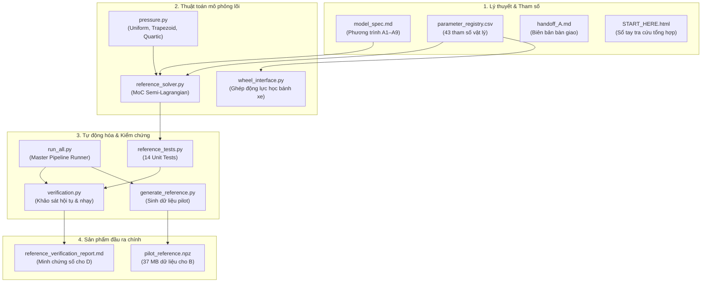

# Member A — LuGre phân bố, áp suất và nghiệm tham chiếu

Đọc [handoff_A.md](handoff_A.md) để bàn giao; [model_spec.md](model_spec.md) để xem phương trình A1–A9; [reference_verification_report.md](reference_verification_report.md) để xem kết quả thực chạy.

## Chạy lại trên Windows

Cài Python 3.12 và dùng terminal tại thư mục này:

```powershell
py -3.12 -m venv .venv
.\.venv\Scripts\python.exe -m pip install -r requirements.txt
.\.venv\Scripts\python.exe run_all.py
```

`run_all.py` chạy verification trước, chỉ sinh dataset nếu gate đạt, sau đó tạo hình, báo cáo và manifest. Tệp CSV là tham số thực thi; không sửa XLSX rồi mong code tự đọc thay đổi. `build_registry.py` chỉ phục hồi bộ tham số phát hành từ nguồn đã khai báo; chạy nó sẽ ghi đè CSV/JSON nên không dùng nếu đã chỉnh định tham số riêng.

Chạy riêng test không cần SciPy/Matplotlib: `python reference_tests.py` (cần NumPy). Test đầy đủ gồm solver độc lập và hình cần toàn bộ requirements.

## Ví dụ API

```python
from parameters import default_parameters
from reference_solver import ReferenceSolver
from wheel_interface import WheelState, HeldBoundary, reference_step

p = default_parameters()
solver = ReferenceSolver(p, nx=257)
z0 = solver.zero_state()
result = reference_step(solver, z0, WheelState(8/p.r), 200.,
                        HeldBoundary(Vx=8., Vy=0.2, Fz=4000.),
                        horizon=0.02, dt_solver=0.001)
print(result['force'][-1], result['force_impulse'])
z_next = result['next_tire_state']  # commit only for the command actually applied
```

Tất cả vận tốc/tải trong ví dụ là benchmark khai báo. Bản này không chứa PINN, vehicle plant hoặc firmware MCU. Bộ số không phải tham số robot được đo. G2 tái dựng ca nguồn chưa có sai số so hình số hóa; G3 chưa có dữ liệu thực nghiệm. Audit mã cũ và xe C được hoãn theo xác nhận của người dùng vì chưa có mã nguồn.

## Cấu trúc thư mục

```text
daktmt_memberA/
├── configs/                                 # Cấu hình hệ thống và bảng tham số chuẩn
│   ├── delivery_manifest.json               # Manifest niêm phong gói bàn giao
│   ├── environment.json                     # Thông tin môi trường thực thi
│   ├── parameter_registry.csv               # Bảng 43 tham số vật lý chuẩn (Single Source of Truth)
│   ├── parameter_registry.json              # Bản JSON của bảng tham số
│   ├── parameter_registry.xlsx              # Bản Excel của bảng tham số
│   ├── parameter_registry.xlsx.inspect.ndjson
│   └── rom_calibration.json                 # Kết quả hiệu chuẩn mô hình bậc rút gọn ROM
├── core/                                    # Mô hình vật lý và bộ giải thuật toán lõi
│   ├── independent_solver.py                # Bộ giải số độc lập (MOL + SciPy BDF) đối chiếu G1
│   ├── parameters.py                        # Cấu trúc dữ liệu và nạp tham số mô hình
│   ├── pressure.py                          # Mô hình 3 họ phân bố áp suất (Uniform, Trapezoid, Quartic)
│   ├── reference_solver.py                  # Bộ giải tham chiếu MoC Semi-Lagrangian chính xác cao
│   ├── rom.py                               # Mô hình bậc rút gọn (Reduced-Order Model)
│   └── wheel_interface.py                   # Giao diện động lực học quay bánh xe & cơ cấu phanh
├── datasets/                                # Bộ dữ liệu tham chiếu chuẩn Ground Truth
│   ├── candidate_metadata.json              # Siêu dữ liệu tập ứng viên
│   ├── candidate_reference.npz              # Dữ liệu nghiệm ứng viên
│   ├── kinematic_configs.json               # Cấu hình 24 kịch bản động học chuyển động
│   ├── manifest.json                        # Manifest tập dữ liệu
│   ├── pilot_reference.npz                  # Dữ liệu tham chiếu pilot (~37.2 MB) cho Member B
│   └── quality_checks.json                  # Kết quả kiểm tra chất lượng & chặn sai số dữ liệu
├── docs/                                    # Tài liệu đặc tả kỹ thuật, bàn giao và báo cáo
│   ├── data_schema.md                       # Đặc tả cấu trúc dữ liệu NPZ
│   ├── handoff_A.md                         # Biên bản bàn giao kỹ thuật cho Member B, C, D
│   ├── member_C_integration.md              # Hướng dẫn chi tiết ghép nối với Member C
│   ├── model_spec.md                        # Đặc tả toán học & vật lý nền tảng (hệ PT A1–A9)
│   ├── reference_verification_report.md     # Báo cáo thẩm định kỹ thuật số nghiệm thu G0–G3
│   ├── section_II_B.md                      # Bản thảo thuyết minh mục II.B
│   ├── section_III_A_physics.md             # Bản thảo thuyết minh mục III.A
│   ├── section_V_A_verification.md          # Bản thảo thuyết minh mục V.A
│   └── source_audit.md                      # Báo cáo rà soát và đối chiếu nguồn tài liệu
├── figures/                                 # Đồ thị và hình vẽ khoa học sinh tự động
│   ├── contact_patch.png                    # Hình dạng vệt tiếp xúc và phân bố áp suất
│   ├── convergence.png                      # Đồ thị hội tụ không gian & thời gian
│   ├── literature_deur_fig4_reconstruction.png # Tái dựng kết quả từ tài liệu Deur (2001)
│   ├── memory_ablation.png                  # Phân tích hiệu ứng nhớ (Memory ablation)
│   ├── pilot_forces.png                     # Đồ thị đáp ứng lực dọc/ngang của dữ liệu pilot
│   └── pressure_ablation.png                # So sánh sai số giữa các họ phân bố áp suất
├── results/                                 # Kết quả tính toán số học, đo đạc sai số và log
│   ├── convergence_space.csv                # Dữ liệu khảo sát hội tụ theo lưới không gian
│   ├── convergence_time.csv                 # Dữ liệu khảo sát hội tụ theo bước thời gian
│   ├── delivery_validation.json             # Kết quả nghiệm thu tính toàn vẹn và chuẩn hóa
│   ├── independent_comparison.csv          # So sánh sai số MoC với bộ giải độc lập
│   ├── literature_reconstruction.csv       # Số liệu tái dựng từ công bố Deur
│   ├── literature_reconstruction.npz       # File dữ liệu tái dựng Deur
│   ├── memory_ablation.npz                 # Dữ liệu phân tích memory ablation
│   ├── pressure_ablation.csv               # Bảng số liệu ảnh hưởng của phân bố áp suất
│   ├── pressure_normalization.csv          # Kiểm tra bảo toàn tải trọng đứng Fz
│   ├── rom_evaluation.csv                  # Đánh giá độ chính xác và tốc độ của ROM
│   ├── sensitivity.csv                     # Phân tích độ nhạy tham số
│   ├── unit_tests.log                      # Nhật ký thực thi 14 bài unit test
│   ├── verification_metrics.json           # Tổng hợp chỉ số thẩm định G0–G3
│   └── wheel_convergence.csv               # Dữ liệu hội tụ tích phân bánh xe
├── scripts/                                 # Kịch bản thực thi pipeline tự động hóa
│   ├── build_registry.py                   # Xuất/tái tạo registry từ nguồn khai báo
│   ├── build_report.py                     # Tổng hợp kết quả thành file báo cáo markdown
│   ├── generate_reference.py               # Sinh tập dữ liệu tham chiếu pilot
│   ├── make_figures.py                     # Vẽ toàn bộ biểu đồ khoa học
│   ├── reference_tests.py                  # Bộ 14 bài unit test kiểm định solver và công thức
│   ├── validate_delivery.py                # Kiểm thử tự động tính toàn vẹn gói bàn giao
│   └── verification.py                     # Kịch bản kiểm chứng hội tụ, nhạy và độc lập
├── README.md                                # Tài liệu hướng dẫn tổng quan gói bàn giao
├── requirements.txt                         # Danh sách thư viện phụ thuộc Python
├── run_all.py                               # Master Pipeline Runner tự động chạy toàn bộ quy trình
└── START_HERE.html                          # Sổ tay tương tác tra cứu tổng quan trên trình duyệt
```

## Bảng tổng hợp các file cốt lõi

| STT | Tệp tin cốt lõi | Định dạng | Vai trò chính trong gói bàn giao |
|:---:|---|:---:|---|
| 1 | [START_HERE.html](START_HERE.html) | HTML | **Sổ tay tổng quan tương tác** tra cứu toàn diện 10 nhiệm vụ và kết quả. |
| 2 | [model_spec.md](model_spec.md) | Markdown | **Đặc tả toán học & vật lý gốc** (hệ phương trình A1–A9, IC/BC, quy ước dấu). |
| 3 | [handoff_A.md](handoff_A.md) | Markdown | **Biên bản bàn giao kỹ thuật** ràng buộc trách nhiệm cho Member B, C, D. |
| 4 | [parameter_registry.csv](parameter_registry.csv) | CSV | **Nguồn chân lý duy nhất (Single Authority)** định nghĩa 43 tham số vật lý. |
| 5 | [reference_solver.py](reference_solver.py) | Python | **Trái tim giải thuật:** Bộ giải số tham chiếu MoC chính xác cao (`float64`). |
| 6 | [pressure.py](pressure.py) | Python | Mô hình 3 họ phân bố áp suất tiếp xúc bảo toàn tải trọng đứng `F_z`. |
| 7 | [wheel_interface.py](wheel_interface.py) | Python | Giao diện động lực học quay bánh xe & cơ cấu phanh ghép nối Member C. |
| 8 | [run_all.py](run_all.py) | Python | **Master Pipeline Runner:** Tự động hóa kiểm thử, sinh dữ liệu, xuất báo cáo. |
| 9 | [pilot_reference.npz](pilot_reference.npz) | NumPy Binary | Bộ dữ liệu tham chiếu Ground Truth lớn (~37.2 MB) cho Member B huấn luyện PINN. |
| 10 | [reference_verification_report.md](reference_verification_report.md) | Markdown | **Báo cáo thẩm định kỹ thuật số** đầy đủ minh chứng thực nghiệm G0–G3. |

---

### Chi tiết nội dung và vai trò kỹ thuật từng tệp

#### 1. [START_HERE.html](START_HERE.html) — Sổ tay tương tác toàn diện
- **Vai trò:** Bản đồ chỉ dẫn trực quan cao nhất của gói công việc, có thể mở trực tiếp bằng trình duyệt web.
- **Nội dung:**
  - Tích hợp thanh menu điều hướng nhanh (Smooth Scrolling Sidebar) sang từng phần nhiệm vụ.
  - Tóm lược toàn bộ 10 nhiệm vụ chính (`A01–A10`) và 4 trách nhiệm liên kết hệ thống.
  - Trực quan hóa hệ phương trình `A1–A9`, bảng số liệu hội tụ không gian/thời gian, so sánh solver độc lập và kết quả nghiệm thu `G0–G3`.
  - Hướng dẫn thực thi pipeline và bảng tra cứu đường dẫn đến tất cả các tệp trong thư mục.

#### 2. [model_spec.md](model_spec.md) — Đặc tả toán học & vật lý nền tảng
- **Vai trò:** Căn cứ lý thuyết cao nhất, định nghĩa chính xác hệ phương trình được mã hóa trong solver.
- **Nội dung:**
  - **Phạm vi:** Vệt tiếp xúc 1D không gian (`x ∈ [0, L]`) với 2D trạng thái sợi cao su (`z_x, z_y`). Lực xuất ra là lực tiếp xúc tác dụng **lên bánh xe / thân xe**.
  - **Hệ phương trình `A1–A9`:**
    - `(A1)` *Động học:* Vận tốc trượt tương đối `v_r = [V_x - r·ω, V_y]^T`, độ lớn trượt `s = ||v_r||_2`, vận tốc vận chuyển `a = |r·ω|`.
    - `(A2)` *Hàm ma sát Stribeck:* `g(s) = μ_k + (μ_s - μ_k)·exp(-(s / v_s)^γ)`.
    - `(A3)` *Hệ số suy giảm:* `C_i(s) = σ_0i·s / g(s)` với `i ∈ {x, y}` dùng chung chuẩn vận tốc trượt `s`.
    - `(A4)` *Phương trình đạo hàm riêng (PDE):* `∂_t z_i + a·∂_x z_i = v_ri - C_i·z_i`.
    - `(A5)` *Điều kiện biên:* Mép vào inflow `z_i(0, t) = 0` khi `a > 0`; khi `a = 0` (xe đứng yên) chuyển thành hệ ODE độc lập tại từng nút.
    - `(A6)` *Ứng suất ma sát & Eulerian damping:* `μ_i = -[σ_0i·z_i + σ_1i·∂_t z_i + σ_2·v_ri]`, trong đó giảm chấn sử dụng đạo hàm riêng thời gian `∂_t z_i`.
    - `(A7)` *Chuẩn hóa áp suất:* Mật độ tải đường pháp tuyến `p(x)` (đơn vị `N/m`) tích phân bằng đúng tải trọng đứng `F_z`.
    - `(A8)` *Lực & Mô-men:* Tích phân lực tiếp tuyến `F_x, F_y` và mô-men tự định hướng `M_z = ∫ (L/2 - x)·q_y dx`.
    - `(A9)` *Thuật toán MoC:* Phương pháp đặc trưng bán-Lagrange (Semi-Lagrangian) cập nhật nghiệm hàm mũ chính xác qua toán tử `φ(q) = -expm1(-q)/q`.
  - **Giới hạn lực vật lý:** Chặn bảo thủ từng thành phần `|σ_0i·z_i| ≤ μ_s` dẫn đến `||F|| ≤ √2·μ_s·F_z`.

#### 3. [handoff_A.md](handoff_A.md) — Biên bản bàn giao kỹ thuật
- **Vai trò:** Hợp đồng kỹ thuật bàn giao sản phẩm của Member A cho Member B, C, D.
- **Nội dung:**
  - Khóa phiên bản thực thi `A-moc-1.0.0`, xác nhận hoàn thành 10 nhiệm vụ `A01–A10`.
  - **Dành cho Member B (PINN):** Cách sử dụng file dữ liệu NPZ, quy tắc bảo toàn tính nhân quả (phải cấp hệ số kích thích tương lai khi dự đoán tương lai, cấm đưa `ω` hoặc lực tương lai vào đặc trưng đầu vào), giữ nguyên phân chia `train/val/test` theo trajectory.
  - **Dành cho Member C (Vehicle Plant):** Tích hợp hàm `reference_step`, quy tắc sao chép snapshot độc lập cho từng ứng viên phanh, chuyển đổi hệ tọa độ thân xe - bánh xe.
  - **Dành cho Member D (Verification):** Hướng dẫn chạy kiểm thử tự động, ngưỡng sai số nghiệm thu pilot.
  - **Điều nhóm được phép giả định:** Dữ liệu chuẩn `float64`, đơn vị SI, không có hiện tượng cắt xén lực nhân tạo (*no force clipping*).

#### 4. [parameter_registry.csv](parameter_registry.csv) — Bảng tham số vật lý chuẩn
- **Vai trò:** Nguồn chân lý duy nhất (Single Source of Truth) lưu trữ toàn bộ tham số của mô hình lốp và cơ cấu phanh (kèm bản Excel duyệt [parameter_registry.xlsx](parameter_registry.xlsx)).
- **Nội dung:** Định nghĩa **43 tham số** với đầy đủ 11 thuộc tính:
  - *Hình học & Tải:* Chiều dài vệt tiếp xúc `L = 0.303 m`, tải danh định `F_z = 4000 N`, bán kính bánh `r = 0.3 m`, quán tính `I_w = 1.2 kg·m²`.
  - *Ma sát Deur:* `μ_k = 0.648`, `μ_s = 1.671`, `v_s = 3.49 m/s`, `γ = 0.6`.
  - *Độ cứng chuẩn hóa:* `σ_0x = 314000 / (0.303 × 4000) ≈ 259.08 m⁻¹`, `σ_0y = 159200 / (0.303 × 4000) ≈ 131.35 m⁻¹`.
  - *Cơ cấu phanh:* Hằng số thời gian trễ `τ_b = 0.02 s`, mô-men cực đại `T_max = 1200 N·m`, tốc độ biến thiên mô-men cực đại `dT_max = 10000 N·m/s`.

#### 5. [reference_solver.py](reference_solver.py) — Bộ giải số tham chiếu MoC
- **Vai trò:** Trái tim thuật toán sinh nghiệm chuẩn tham chiếu chính xác cao.
- **Nội dung:**
  - Lớp `ReferenceSolver`: Lưới không gian mặc định `nx = 257` nút.
  - Hàm `reaction(...)`: Cập nhật nghiệm hàm mũ dọc theo đường đặc trưng, dùng hàm `expm1` triệt tiêu lỗi chia cho 0 khi `C_i → 0`.
  - Hàm `step(...)`: Tìm chân đường đặc trưng `x_foot = x - a·dt` bằng nội suy tuyến tính, tính thời gian lưu trú `min(dt, x/a)` và áp điều kiện biên `z(0, t) = 0`.
  - Hàm `outputs(...)`: Tính phân bố ứng suất ma sát có giảm chấn Eulerian `∂_t z`, tích phân lực `F_x, F_y` và mô-men `M_z`.
  - Hàm `steady_state(...)`: Tính nghiệm dừng giải tích dùng để khởi tạo trạng thái ổn định (warm-up).

#### 6. [pressure.py](pressure.py) — Phân bố tải trọng tiếp xúc
- **Vai trò:** Cài đặt 3 họ phân bố áp suất không thứ nguyên và mật độ tải pháp tuyến đường.
- **Nội dung:**
  - Ba họ phân bố trong hàm `shape(...)`:
    1. `uniform`: Phân bố đều `h(u) = 1`.
    2. `trapezoid`: Phân bố hình thang bất đối xứng của Deur (điểm gãy `r_l = 0.134, r_r = 0.707`).
    3. `quartic`: Phân bố đa thức đối xứng bậc 4 `h(u) = 30·u²·(1 - u)²` tương ứng `Beta(3, 3)`.
  - Hàm `line_load(...)`: Tính mật độ tải pháp tuyến `p(x) = F_z · h(x/L) / ∫ h(u) du` (đơn vị `N/m`), đảm bảo `p(x) ≥ 0` và sai số tích phân tải so với `F_z` đạt mức cực nhỏ (`< 10⁻¹⁵`).

#### 7. [wheel_interface.py](wheel_interface.py) — Giao diện quay bánh xe & Phanh
- **Vai trò:** Cầu nối ghép nối lốp của Member A với hệ thống điều khiển phanh và động lực học xe của Member C.
- **Nội dung:**
  - Hàm `reference_step(...)`: Tích phân ghép đồng thời phương trình chuyển động quay bánh xe:
    ```text
    I_w · (dω/dt) = -T_b - r · F_x
    ```
    và phương trình trễ cơ cấu phanh bậc 1 có giới hạn tốc độ biến thiên mô-men:
    ```text
    dT_b/dt = clip((T_cmd - T_b) / τ_b, -dT_max, dT_max)
    ```
  - Dùng thuật toán điểm giữa tường minh (*explicit midpoint*), tự động chia nhỏ bước tích phân để bắt kịp động lực học bánh xe.
  - Trả về lực, mô-men `M_z`, tốc độ góc `ω`, mô-men phanh `T_b`, xung lực `∫ F dt` và trạng thái lốp kế tiếp.
  - **Cơ chế an toàn:** Ném ngoại lệ ngay lập tức nếu xảy ra hiện tượng `ω ≤ 0` (bánh xe bị khóa hoặc đảo chiều), từ chối giả mạo dữ liệu dừng xe khi chưa có mô hình khóa bánh.

#### 8. [run_all.py](run_all.py) — Master Pipeline Runner
- **Vai trò:** Kịch bản tự động hóa thực thi từ đầu đến cuối, đảm bảo khả năng tái lập 100% của toàn bộ dự án.
- **Nội dung:** Điều phối thực thi tuần tự 6 công đoạn:
  1. `verification.py`: Chạy 14 bài unit test, đo hội tụ không gian/thời gian, đối chiếu solver độc lập, hiệu chuẩn ROM.
  2. `generate_reference.py`: Kiểm tra cổng `G1` đạt `PASS` rồi mới sinh dữ liệu pilot.
  3. `make_figures.py`: Vẽ và xuất 6 biểu đồ khoa học vào thư mục `figures/`.
  4. `build_report.py`: Đọc các tệp kết quả CSV và tổng hợp thành báo cáo `reference_verification_report.md`.
  5. `validate_delivery.py`: Nghiệm thu mã băm SHA-256, kiểm tra khớp Excel/CSV, kiểm tra tính hữu hạn và chặn vật lý.
  6. `make_manifest()`: Quét và niêm phong toàn bộ các file vào `delivery_manifest.json`.

#### 9. [pilot_reference.npz](pilot_reference.npz) — Bộ dữ liệu tham chiếu Ground Truth
- **Vai trò:** Sản phẩm chuyển giao quan trọng nhất cho **Member B** để huấn luyện mạng PINN.
- **Nội dung:**
  - Định dạng: Tệp nén nhị phân NumPy chuẩn (`float64`, không dùng `pickle`).
  - Dung lượng: **~37.2 MB**.
  - Quy mô: **24 chuỗi động học dao động ngẫu nhiên**, được phân chia độc lập thành **16 train / 4 validation / 4 test** theo từng trajectory để chống rò rỉ dữ liệu.
  - Chứa đầy đủ: Toàn bộ lịch sử biến dạng không-thời gian `z(t, x)` kích thước `(24, T, 257, 2)`, lực dọc và ngang `[F_x, F_y]`, mô-men `M_z`, vận tốc trượt `v_r`, tải trọng đứng `F_z` và họ áp suất tương ứng.
  - Mọi chuỗi đều đã vượt qua cổng kiểm tra lưới mịn (*refinement gate*) với sai số cực đại `< 0.021% F_z`.

#### 10. [reference_verification_report.md](reference_verification_report.md) — Báo cáo thẩm định kỹ thuật số
- **Vai trò:** Tài liệu bằng chứng khoa học phục vụ nghiệm thu, nộp bài báo và bảo vệ đề tài.
- **Nội dung:**
  - Báo cáo 14/14 bài unit test đạt `PASS`.
  - Hội tụ không gian: Sai số trường biến dạng giảm **38.88 lần** khi tăng số nút từ 65 lên 513.
  - Hội tụ thời gian: Sai số giảm **63.95 lần** khi giảm bước thời gian từ 4 ms xuống 0.5 ms.
  - Đối chiếu solver độc lập (Upwind MOL + SciPy BDF): Sai số lực cực đại chỉ **`0.062% F_z`**.
  - Mô hình bậc rút gọn ROM: Hệ số đối lưu tối ưu `κ ≈ 1.209`, sai số lực RMSE khoảng 98–112 N, tốc độ nhanh hơn solver tham chiếu khoảng 6 lần.
  - Đánh giá phân loại mức bằng chứng theo chuẩn NASA/AIAA: `G0: PASS`, `G1: PASS`, `G2: PARTIAL`, `G3: NOT_AVAILABLE`.

---

### Sơ đồ liên kết luồng hoạt động giữa các file cốt lõi



---

### Khuyến nghị cách tiếp cận nhanh
1. **Để tra cứu nhanh toàn cảnh:** Mở [START_HERE.html](START_HERE.html) bằng trình duyệt web.
2. **Để nắm vững cơ sở toán học & vật lý:** Đọc kỹ [model_spec.md](model_spec.md).
3. **Để tích hợp vào bài toán của B hoặc C:** Đọc [handoff_A.md](handoff_A.md), tham khảo giao diện trong [reference_solver.py](reference_solver.py), [wheel_interface.py](wheel_interface.py) và nạp dữ liệu từ [pilot_reference.npz](pilot_reference.npz).
4. **Để tái lập toàn bộ quy trình kiểm chứng:** Chạy lệnh `python run_all.py` trong terminal.


